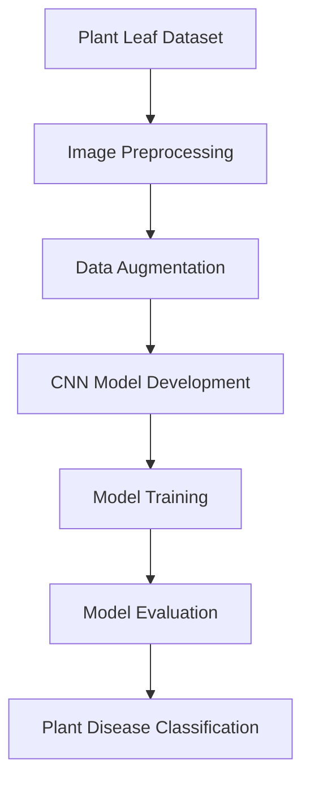

 <p align="center">
  
</p>

<h1 align="center">Flora-MD</h1>

<p align="center">
  <strong>Plant Disease Detection Using Convolutional Neural Networks</strong>
</p>

<p align="center">
  
  
  
  
</p>

---

## 🌱 About the Project

Flora-MD is a deep learning project that explores the use of Convolutional Neural Networks (CNNs) to identify plant diseases from leaf images.

The project focuses on classifying plant leaves into healthy and diseased categories using image processing and deep learning techniques.

## 🎯 Project Overview

Plant diseases can affect crop health and agricultural productivity. Early identification of symptoms can help support timely disease management.

Flora-MD uses a CNN-based image classification approach to recognize three plant leaf conditions.

## 🧠 Disease Classification

| Class | Description |
|---|---|
| Healthy | Healthy plant leaves |
| Powdery | Leaves affected by powdery mildew |
| Rust | Leaves affected by rust disease |

## ⚙️ Model Development

The project uses a custom CNN model developed with TensorFlow and Keras.

The model development pipeline includes:

- Loading and organizing plant leaf images
- Resizing images to 256 × 256 pixels
- Normalizing image pixel values
- Applying data augmentation during training
- Training a CNN-based image classifier
- Evaluating the classification model

### Data Augmentation

The training pipeline includes:

- Random rotation
- Random brightness adjustment
- Random contrast adjustment

## 📊 Dataset

- **Dataset:** Plant Disease Recognition Dataset
- **Number of classes:** 3
- **Image dimensions:** 256 × 256
- **Dataset source:** [Plant Disease Recognition Dataset – Kaggle](https://www.kaggle.com/datasets/rashikrahmanpritom/plant-disease-recognition-dataset)

The dataset is organized into training, testing and validation subsets.

## 🛠️ Technologies Used

| Technology | Purpose |
|---|---|
| Python | Core programming language |
| TensorFlow | Deep learning framework |
| Keras | CNN model development |
| NumPy | Numerical operations |
| Pillow (PIL) | Image processing |
| Plotly | Data visualization |
| Jupyter Notebook | Model development and experimentation |

## 🔄 Project Workflow



## 📓 Project Notebook

Explore the complete model development and experimentation process:

<p align="center">
  <a href="notebook/Plant-Disease-Detection-using-CNN.ipynb">
    
  </a>
</p>

## 📁 Repository Structure

```text
Flora-MD/
│
├── assets/
│   ├── floralogo.png
│   ├── floralogo2.png
│   ├── logo.png
│   └── team.png
│
├── notebook/
│   └── Plant-Disease-Detection-using-CNN.ipynb
│
└── README.md
```

## 🌍 Project Objective

To explore how deep learning and computer vision can be applied to plant disease identification and contribute to technology-assisted agricultural solutions.

---

<p align="center">
  <strong>🌿 Flora-MD — Exploring AI for Healthier Plants.</strong>
</p>
